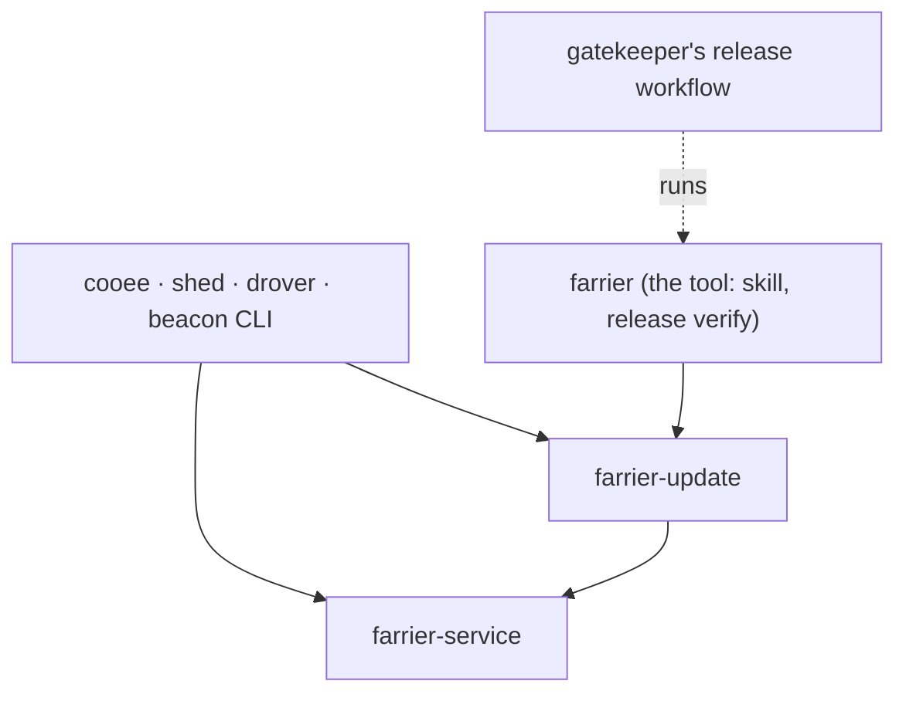
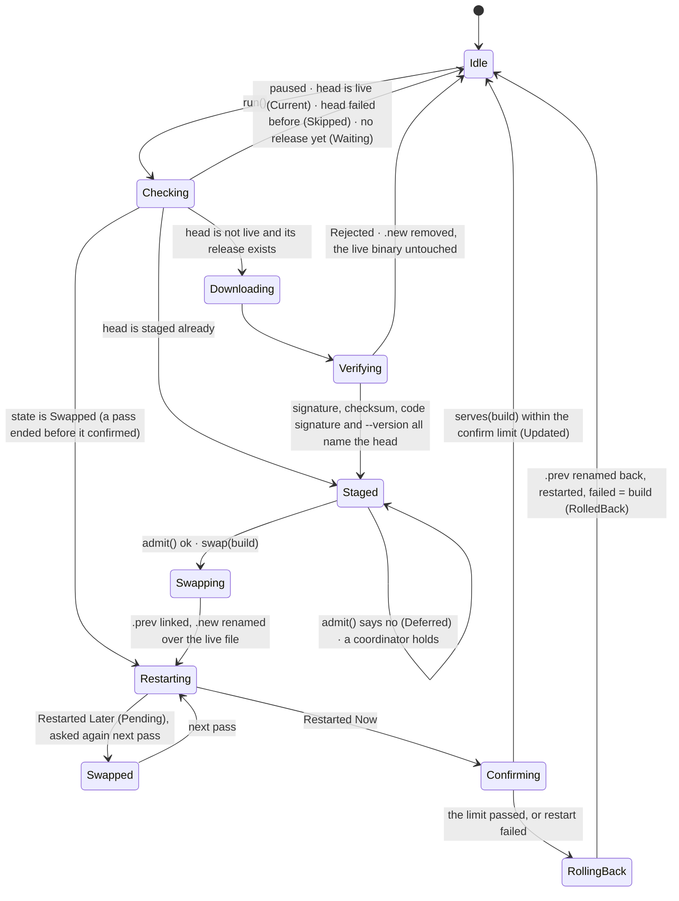

# farrier: shapes, boundaries, statecharts

## Summary

Decision: two library crates and one small tool. The service crate writes, loads, restarts and removes a launchd or systemd job from one typed description. The update crate finds the release of a branch's head, verifies it (signed checksum list, checksum, macOS code signature, the build it reports), swaps it in with one rename, restarts the daemon, and puts the old binary back if the new one does not serve. drover's several-host rollout stays in drover and drives the same two steps (stage, swap) on each host.
Slices: (1) the repo with every gate and the skill command; (2) the service crate; (3) the release contract and its checker; (4) the update crate; (5) adoption in cooee, then shed, then drover, two PRs each; beacon's CLI later.
Open questions: none. The owner decided the signature (Amendment, 2026-11-20): a minisign key, plus a second, offline backup public key compiled in from the first release; farrier cuts its own first releases and moves to gatekeeper's release workflow once that ships.

The decision and its reasons: [adr.md](adr.md). The release layout shared with gatekeeper: [contract.md](contract.md).
What each consumer deletes, the order, and the agent-speed criteria: [adoption.md](adoption.md).

## The callers' usage

A job is a value. The same value renders a plist on macOS and a unit (plus a timer) on Linux.

```rust
use farrier_service::{Env, Files, Job, Launchd, ProcessType, Restart, Schedule, Service, Systemd};

fn serve(exe: &Path, path: &str) -> Result<Job, farrier_service::Error> {
    Ok(Job::new("dev.shed.serve", [exe.as_os_str(), "serve".as_ref()])?
        .schedule(Schedule::KeepAlive(Restart::Always))
        .path(path)
        .launchd(Launchd { process_type: ProcessType::Interactive, abandon_process_group: false })
        .systemd(Systemd { oom_policy_continue: true })
        .supersedes(["shed"]))
}

fn update(exe: &Path, path: &str) -> Result<Job, farrier_service::Error> {
    Ok(Job::new("dev.shed.update", [exe.as_os_str(), "self-update".as_ref()])?
        .schedule(Schedule::Every(Duration::from_secs(300)))
        .path(path)
        .supersedes(["shed-update"]))
}
```

### shed

```rust
pub fn install(force: bool) -> anyhow::Result<()> {
    let env = Env::host()?;
    for job in [serve(&exe, &path)?, update(&exe, &path)?] {
        let service = Service::new(job, &env);
        if service.status()?.files == Files::Differs && !force {
            bail!("{} has other contents; `shed install --force` replaces it", service.label());
        }
        out::line(format_args!("{}: {}", service.label(), service.install()?));
    }
    Ok(())
}

const SHED: Product = Product {
    bin: "shed",
    repo: "jirathip-dev/shed",
    keys: &[include_str!("../release.pub"), include_str!("../release-backup.pub")],
    codesign_id: Some("shed"),
};

struct Serve<'a>(&'a Paths);

impl Daemon for Serve<'_> {
    fn admit(&self, staged: &Staged) -> Result<(), String> {
        handover_check(&self.0.socket, staged)
    }
    fn restart(&self, to: &Build) -> Result<Restarted, String> {
        handover(&self.0.socket, to)
    }
    fn serves(&self, to: &Build) -> bool {
        Client::connect(&self.0.socket).is_ok_and(|c| to.matches(&c.server().build))
    }
}

pub fn self_update(paths: &Paths, args: &Args) -> anyhow::Result<ExitCode> {
    let install = Install { exe, state: paths.update_dir() };
    let updater = Updater::new(&SHED, install, Channel::Main).daemon(&Serve(paths));
    let outcome = match (args.pause, args.resume, args.dry_run) {
        (true, ..) => updater.pause()?,
        (_, true, _) => updater.resume()?,
        (.., true) => updater.plan()?,
        _ => updater.run()?,
    };
    out::line(&outcome);
    Ok(outcome.exit())
}
```

`shed doctor` keeps its rows and reads them from `service.status()` and `updater.status()`.

### cooee

```rust
let service = Service::new(jobs::serve(config)?, &Env::host()?);
let serve = Supervised::new(&service, |_| port_answers(config.port));
let install = Install { exe: bin, state: data.join("update") };
let updater = Updater::new(&COOEE, install, Channel::Main).daemon(&serve);
match updater.run()? {
    bad @ (Outcome::RolledBack { .. } | Outcome::Rejected(_)) => {
        push.send_now(None, &note(&bad));
        Err(bad.to_string())
    }
    done => log(&data, &done),
}
```

`cooee setup` and `cooee install` call `service.install()` or `service.write()` and print `service.commands()`.

### drover

```rust
for job in jobs::own(ctx, cfg)? {
    let service = Service::new(job, &env);
    lines.push(match service.install() {
        Ok(done) => format!("✓ {done}"),
        Err(e) => format!("✗ {e} → {}", service.commands().load),
    });
}

for m in members.iter_mut().filter(|m| m.needs(&head) && !m.staged(&head)) {
    m.staged = m.phase(Phase::Stage, &head);
}
match step(now, &head, &found, &members, &marks, &cfg.limits) {
    Step::Swap { ready, behind } => swap(ctx, cfg, &members, ready, behind),
    other => report(out, other),
}
```

`step` is today's function, unchanged. `Member::phase` is `updater.stage(&head)` or `updater.swap(&head)` on the
main host, and on another host the same call made by that host's own binary: the coordinator runs
`drover self-update --phase stage <sha>` there over its transport and reads the one JSON line it prints with
`farrier_update::phase::parse`. A host with no binary yet is started with `farrier_update::fetch` on the main host
(verified there for the host's target) and a copy.

### beacon's CLI (later)

`beacon install` becomes one `Job` and `service.install()`. Its updater uses `Supervised` like cooee's.

## Data shapes

### farrier-service

```rust
pub struct Label(String);

pub struct Job {
    pub label: Label,
    pub argv: Vec<OsString>,
    pub schedule: Schedule,
    pub path: String,
    pub log: Log,
    pub launchd: Launchd,
    pub systemd: Systemd,
    pub supersedes: Vec<String>,
}

pub enum Schedule {
    KeepAlive(Restart),
    Every(Duration),
    Daily { hour: u8, minute: u8 },
}
pub enum Restart { Always, OnFailure }
pub enum Log { Default, File(PathBuf) }
pub enum ProcessType { Standard, Interactive, Background }
pub struct Launchd { pub process_type: ProcessType, pub abandon_process_group: bool }
pub struct Systemd { pub oom_policy_continue: bool }

pub enum Platform { Launchd, Systemd }
pub struct Env { pub platform: Platform, pub home: PathBuf, pub config_home: PathBuf, pub uid: u32 }

pub struct Service { /* job, env */ }
pub enum Installed { Unchanged, Written, Loaded }
pub enum Removed { Absent, Removed }
pub enum Files { Same, Differs, Missing }
pub struct Status { pub files: Files, pub loaded: bool, pub pid: Option<u32>, pub refused: Option<String> }
pub struct Commands { pub load: String, pub unload: String, pub restart: String, pub log: String }

impl Service {
    pub fn new(job: Job, env: &Env) -> Self;
    pub fn files(&self) -> Vec<(PathBuf, String)>;
    pub fn write(&self) -> Result<Installed, Error>;
    pub fn install(&self) -> Result<Installed, Error>;
    pub fn uninstall(&self) -> Result<Removed, Error>;
    pub fn start(&self) -> Result<(), Error>;
    pub fn stop(&self) -> Result<(), Error>;
    pub fn restart(&self) -> Result<(), Error>;
    pub fn status(&self) -> Result<Status, Error>;
    pub fn commands(&self) -> Commands;
}
```

- `Label` is checked once, in `Job::new`: lowercase reverse-DNS. It is the plist's `Label`, the plist's file name and
  the systemd unit's name (`dev.shed.serve.service`), so a job has one name everywhere.
- `Schedule` is the whole difference between a daemon and a timer job; a `Daily` or `Every` job gets a `.timer` on
  Linux. `RunAtLoad` is always on.
- `Log::Default` is `~/Library/Logs/<label>.log` on macOS and the journal on Linux.
- `supersedes` names jobs this one replaces (an old label, an old unit name). `install` unloads and removes them.
- `Env::host()` is the only place that reads the real platform, home and uid. A test builds its own `Env` over a
  temp folder, so both platforms' files and calls are tested on every OS.
- Every verb is idempotent. `install` writes only on a difference, loads only when not loaded, and re-bootstraps a
  job launchd refuses (`spawn failed`, a code-signing refusal after a swap), three tries with backoff. `restart`
  does the same before it gives up.
- Jobs are per user (LaunchAgents, `systemctl --user`). System-wide jobs are out of scope: no consumer has one.

### farrier-update

```rust
pub struct Product {
    pub bin: &'static str,
    pub repo: &'static str,
    pub keys: &'static [&'static str],
    pub codesign_id: Option<&'static str>,
}

pub struct Build(String);
pub enum Channel { Main, Branch(String) }
pub struct Target { pub os: Os, pub arch: Arch }
pub struct Install { pub exe: PathBuf, pub state: PathBuf }
pub struct Staged { pub path: PathBuf, pub build: Build }
pub struct Limits { pub download: Duration, pub probe: Duration, pub confirm: Duration }

pub trait Daemon {
    fn admit(&self, staged: &Staged) -> Result<(), String> { Ok(()) }
    fn restart(&self, to: &Build) -> Result<Restarted, String>;
    fn serves(&self, to: &Build) -> bool;
}
pub enum Restarted { Now, Later(String) }
pub struct Supervised<'a, F> { /* &Service, F: Fn(&Build) -> bool */ }
pub struct NoDaemon;

pub enum Outcome {
    Paused { since: u64 },
    Resumed,
    Current(Build),
    Waiting { tag: String, why: String },
    Skipped { build: Build, why: String },
    Rejected(Reject),
    Staged(Build),
    Deferred { build: Build, why: String },
    Pending { build: Build, why: String },
    Updated { from: Option<Build>, to: Build },
    RolledBack { to: Build, why: String, serving: bool },
    Would(Box<Outcome>),
}
pub enum Reject {
    NoAsset(String),
    Download(String),
    Signature(String),
    Checksum,
    CodeSign(String),
    Version(String),
}
pub struct Builds { pub live: Option<Build>, pub staged: Option<Build> }

pub struct State { pub at: u64, pub resting: Resting, pub failed: Option<Build>, pub last: String, pub ok: bool }
pub enum Resting { Idle, Staged(Build), Swapped { from: Option<Build>, to: Build, at: u64 } }

impl Updater<'_> {
    pub fn new(product: &Product, install: Install, channel: Channel) -> Self;
    pub fn daemon(self, daemon: &dyn Daemon) -> Self;
    pub fn limits(self, limits: Limits) -> Self;
    pub fn plan(&self) -> Result<Outcome, Error>;
    pub fn run(&self) -> Result<Outcome, Error>;
    pub fn stage(&self, to: &Build) -> Result<Outcome, Error>;
    pub fn swap(&self, to: &Build) -> Result<Outcome, Error>;
    pub fn builds(&self) -> Builds;
    pub fn status(&self) -> State;
    pub fn pause(&self) -> Result<Outcome, Error>;
    pub fn resume(&self) -> Result<Outcome, Error>;
}
pub fn fetch(product: &Product, channel: &Channel, build: &Build, target: Target, to: &Path) -> Result<Staged, Reject>;

pub mod phase {
    pub enum Phase { Builds, Stage, Swap }
    pub struct Reply { pub outcome: Option<Outcome>, pub builds: Builds }
    pub fn run(updater: &Updater, phase: Phase, build: &Build) -> String;
    pub fn parse(line: &str) -> Result<Reply, Error>;
}
```

- `Build` is 7 to 40 lowercase hex characters of a commit; two builds match when one is a prefix of the other.
  A binary with no build in its `--version` is a dev build and matches nothing.
- `Install` names the live file. The staged file is `<exe>.new`, the previous one `<exe>.prev` (one generation,
  a hard link taken just before the swap). `state` holds `state.json`, `lock` and `paused`; nothing else.
- `Daemon` is the consumer's whole part: may this build take over, put it in service, does it serve. `Supervised`
  is the ready one for "restart my `Service`, then ask a probe"; `NoDaemon` is a plain CLI.
- `Outcome` is every way a pass ends, and its `Display` is the one line all tools print. `exit()` is nonzero for
  `Rejected`, `RolledBack` and a `Skipped` build. `Reject::retry()` is true only for `Download`.
- `State` is `state.json`. `phase::run` is what a consumer's hidden `--phase` verb prints: one JSON `Reply` line,
  read on the other side by `phase::parse`, so both ends of a rollout share one shape.
- farrier logs and alerts nothing. A consumer turns an `Outcome` into its own event, push or doctor row.
- `Error` is for a pass that could not run at all (the state folder, the lock, no `git` or `curl`).

## Module boundaries



| crate | module | does | may use |
|---|---|---|---|
| farrier-service | `job` | `Label`, `Job`, `Schedule`: the types and their checks | nothing |
| | `render` | a `Job` to file texts, one file per platform (`launchd.rs`, `systemd.rs`); pure | `job` |
| | `ctl` | the only module that starts `launchctl` or `systemctl`, and the only one that waits | `job` |
| | `env` | `Env`, `Platform`; the only `cfg(target_os)` in the crate | nothing |
| | `service` | `Service`: install, uninstall, start, stop, restart, status | `job`, `render`, `ctl`, `env` |
| farrier-update | `id` | `Build`, `Channel`, `Target`, the tag and asset names; the only `cfg(target_os)` | nothing |
| | `contract` | parse `SHA256SUMS`, check the signature and its comment, read a `--version` line; pure | `id` |
| | `tool` | the only module that starts `git`, `curl`, `codesign` or a staged binary | `id` |
| | `stage` | download, verify, probe; leaves `<exe>.new` or nothing | `id`, `contract`, `tool` |
| | `swap` | link `.prev`, rename `.new`, put `.prev` back; file system only | `id` |
| | `state` | `state.json`, the lock, the pause marker | `id` |
| | `updater` | the statechart below; `Daemon`, `Supervised`, `phase` | all above, `farrier_service::Service` |
| farrier | `skill`, `release` | `farrier skill --to <dir>`, `farrier release verify` | `farrier_update::contract`, `id` |

Rules, each enforced by `drover arch-check` (the layers and bans in [adr.md](adr.md)):

- A consumer uses the two crates' public items only. The crates never name a consumer.
- farrier-service knows nothing of updates. farrier-update restarts through `Daemon`; only `Supervised` touches a
  `Service`.
- No module but `ctl` and `tool` starts a process or sleeps; no module but `env` and `id` reads the platform.
- Neither crate prints. Neither holds a release workflow, a signing step or a key: those are gatekeeper's.

## Statechart: one host's update



- `Staged` and `Swapped` rest on disk (`<exe>.new`, `state.json`), so a pass that dies resumes where it stopped
  and a coordinator can leave a host staged for as long as it likes.
- Only one rename changes the live file, and the live file is never written in place (macOS checks a running
  binary's signature per file).
- A build is marked `failed` after a roll back or a reject that cannot heal (`Signature`, `Checksum`, `CodeSign`,
  `Version`); later passes skip it until the head moves. A `Download` reject is tried again.
- `run()` is the whole chart. `stage(build)` ends at `Staged`; `swap(build)` starts there and refuses any other
  staged build. `plan()` walks the chart read-only and wraps what it would do in `Would`.
- `pause` only stops `run()`; `stage` and `swap` are explicit commands.

## Statechart: a rollout over several hosts (drover's, kept in drover)

```mermaid
stateDiagram-v2
    [*] --> Seen: the head is not live on some member
    Seen --> Waiting: no release for the head
    Waiting --> Waiting: alert once after self_update_wait_minutes
    Waiting --> Staging: the release is found
    Seen --> Staging: the release is found
    Staging --> Stuck: the main host cannot stage
    Staging --> Hold: the main host is staged, a waited member is not
    Hold --> Swapping: every waited member is staged, or self_update_lag_minutes passed
    Staging --> Swapping: every waited member is staged
    Swapping --> Updated: the other members swap, then the main host, last
    Updated --> [*]: a member that did not swap is behind; a later pass catches it up
```



- Each member's `Staging` step is farrier's `stage(build)` on that host, at most `self_update_stage_secs`; each
  `Swapping` step is farrier's `swap(build)`. The main host's swap runs the full restart, confirm and roll back.
- `Swapping` holds new lanes off the other hosts until `Updated`, at most `self_update_swap_secs`.
- The chart, its limits, its events and who is `waited` stay drover's: they read drover's host list and event log.
